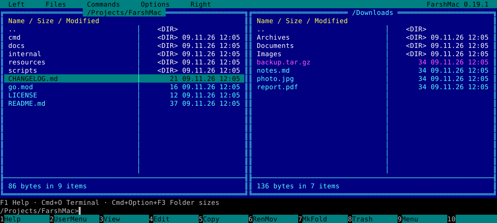

# FarshMac

**The two-panel workflow you know. A Mac window, a real shell, and Go underneath.**

[](https://github.com/ikimpriv/FarshMac/actions/workflows/ci.yml)
[](https://github.com/ikimpriv/FarshMac/actions/workflows/signed-build.yml)
[](LICENSE)
[](https://github.com/ikimpriv/FarshMac/releases)

A native macOS file manager written in Go, inspired by the keyboard-driven workflow and appearance of [Far Manager](https://www.farmanager.com/).

**Version 0.27.0 · macOS 12+ · Apple Silicon and Intel**

**File context menu (F11 / Alt+Enter):** compose a message with attachments in the macOS Mail sharing service, create a ZIP / tar.gz / tar.bz2 archive, or choose an installed application compatible with all selected files. FarshMac does not send email itself. Remote files are staged locally for external applications and retained until the FarshMac window closes.

**Connections:** Left / Right and Alt+F1 / Alt+F2 include FTP/SFTP, Kubernetes and Docker connection actions. The Recent connections section shows 15 entries, newest first regardless of connection type; older connection locations remain saved. Choosing a recent connection starts restoration directly, without opening its settings form. The last folder and cursor are restored when available.

**Pod context menu:** Alt+Enter / F11 → Attach ephemeral container… selects PodToast, a saved launch preset, or a new image with configurable access and startup options. Alt+F9 maximizes/restores the window.

[Changelog](CHANGELOG.md) · [File operations](docs/FILE_OPERATIONS.md) · [Contributing](CONTRIBUTING.md) · [PodToast container agent](podtoast/README.md)

FarshMac uses a Cocoa window and an offline WebKit/xterm.js interface. It is an independent implementation, not the official Far Manager or a source-compatible port. Far Group does not endorse this project.



*Interface preview rendered by FarshMac with sample files.*

## Download

[**Download the latest preview →**](https://github.com/ikimpriv/FarshMac/releases/tag/v0.27.0)

Unzip the universal macOS archive and move **FarshMac.app** to Applications. Apple Silicon and Intel executables are included. The release includes a SHA-256 checksum.

**Early preview:** builds use a persistent self-signed certificate, not Developer ID or notarization. macOS may require per-app approval in **System Settings → Privacy & Security**. Full Disk Access is a separate, optional permission for protected folders. See the [release notes](docs/releases/v0.27.0.md) for installation details and known limitations.

## Features

- Two file panels, masks and selection, window bookmarks for folders and documents, sorting, directory sizes, and multiple windows with saved positions and folders.
- Persistent bash, sh, or zsh terminal with bidirectional folder synchronization, color, mouse support, and bounded scrollback spooled to temporary files.
- Internal viewer and editor, Chroma syntax highlighting, autoindent, search, and external application integration.
- On-demand iCloud / macOS File Provider materialization for F3, F4 and Quick view. Esc cancels FarshMac’s wait; the provider may continue its download in the background.
- ZIP, TAR, compressed TAR, and other archive formats; enter archives as folders and copy files out.
- FTP, FTPS, and SFTP panels, saved connection profiles, configurable parallel copying, and a persistent SSH terminal for SFTP panels.
- Kubernetes panels (client-go, no kubectl needed): namespaces, resource types and objects as folders, manifests in the viewer/editor, logs, describe, container file systems and commands run inside containers.
- Live pod metrics dashboards: discover Prometheus endpoints and PodToast, search and overlay series, normalize charts, and detach an independent window. See [Metrics](docs/METRICS.md).
- Trash by default, explicit permanent deletion, cancellable background operations, and copy metadata options.
- Link-aware local copy and move: relative symbolic links keep pointing at the same object (Smart, the default; As is and Copy contents are also available in the F5/F6 dialog), and hard-linked files copied together stay hard links.
- Graphical image/PDF quick view and an information panel with macOS disk, memory, and power data.

## Build and run

You need **macOS 12 or later**, **Xcode Command Line Tools**, and **Go 1.25 or later**. CGO is required. Node.js 22+ is needed only to run renderer tests. The app bundles its web assets; it does not download scripts at runtime.

Clone the repository, then build:

```sh
git clone https://github.com/ikimpriv/FarshMac.git
cd FarshMac
```

From the repository root:

```sh
xcode-select --install  # only if Command Line Tools are not installed
./scripts/build.sh
open "build/FarshMac.app"
```

For a universal application containing both architectures:

```sh
./scripts/build.sh --universal
```

For development with explicit starting folders:

```sh
go run ./cmd/farshmac -left "$HOME" -right /tmp
```

Local builds automatically reuse the `FarshMac Local Development` code-signing identity if installed; otherwise they use ad-hoc signing. Run `./scripts/setup-local-signing.sh` once to create that identity in login Keychain without an Apple Developer account. macOS may request Keychain approval. This provides stable local signing, but the app is **not notarized**. For local permission behavior, signing, and release packaging, see [Publishing](docs/PUBLISHING.md). Optional Full Disk Access must be enabled by the user in macOS System Settings; the app cannot grant it to itself.

## Keyboard essentials

Most ⌘ shortcuts also work with Ctrl (handy on external keyboards). Ctrl-only: Ctrl+Q, Ctrl+L, Ctrl+H, Ctrl+E/X. ⌘-only: ⌘0…9 and ⌘⌥0…9 bookmarks, ⌘+ / ⌘−. ⌘ letter shortcuts follow the physical key on non-Latin keyboard layouts.

| Key | Action |
| --- | --- |
| Tab | Switch active panel (a hidden panel is skipped) |
| Cmd+O | Switch between panels and terminal; synchronize the folder |
| Cmd+Option+F3 | Calculate all displayed folder sizes |
| Shift+F3 / Alt+F3 / Shift+F4 | Kubernetes panel: logs / follow logs in the terminal / describe |
| Ctrl+Shift+Q | Toggle Quick Live Metrics in the opposite panel for selected Kubernetes pods/containers, namespace/workload folders, or Docker containers; 1/2/3 toggle CPU/memory/storage, P pauses, PgUp/PgDn pages the legend |
| F3 / F4 | View / edit; F3 on an image or PDF opens a graphical view (black background, picture centred, Esc closes); F3 on a folder calculates selected folder sizes, F4 on a folder opens File attributes |
| Alt+F3 / Alt+F4 | Alternate viewer / editor; Cmd+Shift+F3 / Cmd+Shift+F4 force the internal one |
| F5 / F6 / F7 | Copy / move / make folder (asks before overwriting; a new destination ending in `/` is created as a folder) |
| Shift+F5 / Shift+F6 | Enter a new name to copy / rename the current item in the same folder or namespace (local, FTP/SFTP, container files, Kubernetes resources) |
| Alt+F6 | Create a symbolic link (relative by default) or hard link; naming an existing folder creates the link inside it |
| F8 | Move to Trash |
| Shift+F8 / Shift+Delete | Delete permanently (always asks) |
| Shift+F1 / Shift+F2 / Shift+F3 | Create archive / extract archive / archive commands |
| Alt+F7 / Alt+F8 | Find file / command history (Alt+F8 only inserts the command) |
| Alt+F11 / Alt+F12 | File view/edit history / folder history |
| F9 | Open the menu |
| Cmd+R | Re-read the active panel (F9 → Left/Right → Re-read for a specific panel) |
| Cmd+Shift+. / Ctrl+H | Show / hide hidden files |
| Cmd+Enter | Insert the selected filename into the command line |
| Cmd+F / Cmd+; | Insert the full path from the active / inactive panel |
| Ctrl+Insert / Cmd+C | Copy the command line or selected names (on `..`, the panel path) |
| Shift+Enter | Open with macOS / Finder (the parent entry opens the current folder; launches `.app` bundles; Enter enters them as folders) |
| Ctrl+Q / Ctrl+L | Toggle quick view / information in the other panel |
| ⌘⌥0…9 / ⌘0…9 | Save / go to a bookmark, the same keys as in the viewer/editor. A folder bookmark remembers the folder and the file under the cursor. Bookmarks are shared with the viewer/editor and belong to the window: they are not saved and other windows do not see them |
| Ctrl+↑/↓, Cmd+↑/↓ | Previous / next command from history |
| Cmd+Shift+H | Shell command history (terminal mode): Enter to run, F4 to edit |
| Cmd++ / Cmd+− | Font size larger / smaller (10–24); in terminal mode Cmd+= also zooms in and Cmd+0 resets, in panels Cmd+= opens the same local/remote folder or Kubernetes location in the other panel, unless either panel is Quick view |
| Ctrl+Cmd+F | Full screen |
| Cmd+N / Cmd+W | New window (inherits folders and histories) / close window |
| Cmd+Q | Quit; F10 closes only the viewer/editor and does nothing in panels |

In the viewer and editor:

| Key | Action |
| --- | --- |
| F2 | Viewer: toggle wrap (Shift+F2 word/character wrap). Editor: save (Shift+F2 Save as) |
| F6 | Switch viewer / editor, keeping text and cursor |
| F7 / Shift+F7 / Alt+F7 | Search / next / previous match (Space also finds the next match in the viewer) |
| F8 / Shift+F8 | Toggle CP866 / Windows-1251 / choose a code page |
| F9 | Encoding, line endings, BOM, read-only and editor settings |
| F12 | Switch open document screens |
| Cmd+R | Reload from disk (asks if there are unsaved changes) |
| Cmd+Z / Cmd+Shift+Z | Undo / redo (viewer: previous position) |
| Cmd+Left/Right, Cmd+Up/Down, Option+Left/Right | Editor: line start/end, document start/end, word movement |
| Cmd+0…9 / Cmd+Option+0…9 | Go to / set a bookmark. Bookmarks are shared with the panels: a document bookmark reopens the file at the saved position from the panels or any other document (end of file if it shrank, nothing if the file is gone); a folder bookmark returns to the panels |
| Ctrl+Insert / Shift+Delete | Copy / cut |

The editor saves atomically and keeps extended attributes, ACLs and hidden/nodump flags; if some cannot be kept it reports "Saved; some attributes were not preserved". A failed save offers Retry / Save as… / Cancel; a file changed or deleted on disk asks before overwriting or recreating it; in an unwritable folder **Save in place** rewrites the file non-atomically and keeps hard links. Opening a file that probably cannot be saved asks View / Edit anyway / Cancel. Saving through a symbolic link writes the link target.

The terminal is bash by default (sh or zsh in Options → Terminal settings) and gets `TERM_PROGRAM=FarshMac`. If the shell exits it restarts with a 1/2/4/8 s backoff and stops after 5 failed starts; press Enter or Cmd+O to retry. Click the status line, or use Commands → **Last messages…**, to see the last 20 messages.

F1 opens the complete in-app keyboard reference. On keyboards configured for media keys, hold Fn to use F1–F12. Files → **Calculate all folder sizes** calculates all displayed folders. Calculated sizes participate in size sorting. They remain in memory when navigating back or refreshing; `~` marks a cached, possibly outdated value, and `>=` marks an incomplete scan. Recalculate with F3 or Cmd+Option+F3. Previous-directory snapshots are limited to 128 directories, 16,384 results, and a 2 MiB estimated storage budget per panel; least recently used snapshots expire. The current panel is separate from this history budget. Sizes are not saved across application restarts.

## Kubernetes panel

**Kubernetes cluster…** offers local kubeconfig discovery, configs on an SSH server (including kind/k3s APIs bound to loopback), and a library of named pasted configs. A saved config can supply multiple contexts and direct or SSH connections. Profiles contain connection metadata only; explicitly pasted credentials are stored separately in private files. See [Kubernetes connections](docs/KUBERNETES_CONNECTIONS.md) for setup, SSH authentication and supported configuration sources.

The cluster is shown as folders: `/` lists namespaces, a namespace lists resource types that have objects (`deployments`, `services`, `configmaps`, CRD types; a type present in several API groups is named `plural.group`), a type lists its objects with the same STATUS/READY column as `kubectl get`, and an object lists the types of objects it owns. ReplicaSets and ControllerRevisions are collapsed, so `deployments/app/pods` holds the Deployment's pods directly, and `services/web/pods` holds the pods matched by the Service selector. Cluster-scoped objects (nodes, volumes, cluster roles) are not shown.

| Level | Keys |
| --- | --- |
| Namespaces | F3/F4 manifest, F5 export every manifest of a namespace, F7 new namespace, F8 delete (type the name), Shift+F4 describe |
| Type folder | F3 manifest without managedFields (read-only), F4 edit without status, managedFields and other server-managed fields and save with Update (conflicts are reported, your text is kept); manifests are highlighted as YAML, checked against the kind's schema from the cluster (CRDs included) with problem lines marked, Ctrl+Space completes fields and enum values (required first; objects and arrays are inserted with their first child line or `- ` item), a dim hint after the cursor line shows what the field expects, Alt+F2 jumps to the next problem, F5 export `name.yaml` (or a folder tree), F8 delete, Shift+F8 delete keeping children, Shift+F3 logs, Alt+F3 follow logs in the terminal, Shift+F4 describe |
| Pod | Enter lists containers (a pod with one ordinary container opens its file system directly); Shift+F3 / Alt+F3 / Shift+F4 on a container |
| Namespace, type folder, object | F5 from a local panel applies the selected YAML/JSON files (folders recursively, as exported) with server-side apply into that namespace, which replaces the namespace named in the manifests; F5 from another cluster panel applies the selected objects' cleaned manifests there; a Force toggle takes fields over from other field managers |
| Container file system | Enter, F3, F4, F5 (both directions, also between containers), F6, F7, F8 work through `sh`/`tar`/`find`/`stat`/`ls`/`cat` found in the container (GNU, BusyBox and shell-only images: without ls/stat/find the listing shows names and types only, without cat files are read-only); a command typed at the prompt runs in the container (`pod:ns/pod/container:/dir>`), ⌘. stops it, and when it ends the panels return automatically; Cmd+O shows the retained output and live shell; **Kubernetes → Open shell in container** gives an interactive shell |

Shift+F5 copies the current resource under a new name in the same namespace; Shift+F6 renames it by creating a new object and deleting the original. F6 between Kubernetes resource panels moves selected resources to the destination namespace or cluster. These operations use the same resource abstraction for built-in kinds and CRs. Existing names are not overwritten by rename/move. A move deletes the source only after the destination is created, with UID/resourceVersion preconditions; if deletion fails, both objects remain and an error is shown. Moves are not atomic, and owned resources remain orphaned rather than being deleted or silently reparented. Namespace rename/move is not supported.

F5/F6 use the other panel as their destination, including local volumes, FTP/SFTP and container filesystems. Cross-filesystem moves copy before deleting the source; a failed or skipped copy retains its source. Shift+F5/F6 accept a name only and cannot change the destination folder or namespace.

When both filesystem panels point to the same pod/container, file contents are copied inside the container and moves use its `mv`; no file payload is downloaded to the Mac. The same applies to Shift+F5/F6. Collision handling, staged publication, metadata options, progress and cancellation still apply. Archive panels remain read-only.

After a namespace is listed its resource types are watched, so the panel updates itself when objects appear, change or disappear (Cmd+R forces a full re-list). Ctrl+Q opens a Quick view that shows `kubectl describe` of the entry under the cursor (headers and keys highlighted) or the start of a file inside a container; Tab into the Quick view and scroll it with the arrows, PageUp/PageDown, Home and End. Objects that own nothing are shown as files (Enter shows the manifest); owners and pods are folders. The columns show kind, status and age (Detailed: creation time). The F9 **Kubernetes** menu lists these commands plus **Switch context…** and **Disconnect**. Exporting Secrets asks first. In a container filesystem, Cmd+O and panel commands share the container shell (or an attached ephemeral toolbox); in a local filesystem, they use the local shell.

## Tests

```sh
./scripts/check.sh
./scripts/check.sh --race
```

The suite uses temporary directories and loopback FTP/SFTP servers. No real server credentials are needed. Tests that inspect a personal shell configuration or contact a real SFTP server are opt-in and excluded from the standard check script.

GitHub Actions runs checks and produces an ad-hoc universal ZIP artifact. A separate manual **Signed macOS release** workflow can reuse the same certificate as local builds through protected environment secrets; see [CI signing setup](docs/PUBLISHING.md#moving-signed-builds-to-github-actions). Version tags trigger the signed workflow, which publishes the verified ZIP and checksum after successful checks. Manual runs build artifacts without publishing.

## Scope and limitations

This is an early release. Far Manager plugin binaries and macros are not compatible. Kubernetes panels do not calculate folder sizes, and are not restored with the session. Archive panels are read-only; editing an archive member requires extracting it first. Encrypted archives are refused ("Encrypted archives are not supported"), and some nested archive workflows are not supported. Remote metadata and rename behavior depend on the server. SFTP host keys are checked against `~/.ssh/known_hosts`; an unknown host can be trusted once or with **Trust and save**, while a changed or revoked key is refused. Settings are shared live between windows; one instance owns the window session at a time. Windows-specific information and actions are replaced with macOS equivalents.

See [archive support](ARCHIVE_SUPPORT.md), [terminal behavior](TERMINAL_PARITY.md), and [viewer/editor notes](VIEWER_EDITOR_PARITY.md). The detailed parity audits and [development history](docs/DEVELOPMENT_HISTORY.md) record implementation work over time; some older entries describe previous versions.

## Repository layout

- `cmd/farshmac/` — application entry point.
- `internal/ui/` — file panels, menus, dialogs, viewer, and editor.
- internal/shellsession/ — session ownership, context synchronization and command lifecycle; see [architecture](docs/SHELL_SESSIONS.md).
- `internal/terminal/`, `internal/native/` — PTY sessions, scrollback storage, Cocoa bridge, and bundled renderer.
- `internal/fsops/`, `internal/remotefs/` — local/archive operations and network filesystems.
- `internal/highlight/`, `internal/preview/`, `internal/sysinfo/` — isolated highlighting/preview helpers and macOS information.
- `resources/` — application icon and upstream attribution.
- `scripts/` — checks, building, and release packaging.

## License

Our code is licensed under [MIT](LICENSE). Third-party components retain their respective licenses; see [THIRD_PARTY_NOTICES.txt](THIRD_PARTY_NOTICES.txt). The original Far Manager icon is distributed with its upstream BSD-3-Clause notice and [provenance](resources/upstream/README.md).

### Pod traffic monitoring and faults

F11 / Alt+Enter → Traffic monitoring / faults opens a separate graphical window for the selected pod. PodToast **0.7.0** observes existing TCP/UDP sockets over IPv4/IPv6 and counts per-flow IP bytes without redirecting traffic. Select connections or incoming/outgoing port groups for an overlay and optional sum. Short-lived flows remain in port totals. Fault injection is a separate explicit action for one IPv4 TCP port; its proxy supports Conditions, Block/Unblock, Clear and Reset, per connection or port. Stop fault injection keeps passive monitoring open; Esc / Cmd+W closes and cleans up. Requires an allowed Network profile. Counters start at monitor launch, have bounded retention and report capture limitations; TLS decryption is not supported. See [scope and cleanup](podtoast/TRAFFIC.md).

### Metric display and chart assignment

Adding a metric opens a destination dialog: create a separate chart or choose an existing one, with an explicit display mode (Auto, raw value, interval change, rate per second). Selected metrics have visible chart and transform controls; click a legend item to locate its settings. Chart removal deselects its metrics instead of moving them into an unrelated chart. Mixed units are flagged; normalize the chart to compare shapes. Layouts retain these choices.

Auto uses exporter types, falling back to known cumulative names (including untyped MediaMTX byte/packet counters). It does not infer a counter merely because values increase. Override the value type as cumulative counter or gauge when the exporter is ambiguous. Counter decreases are treated as resets; first samples and failed/long scrape gaps remain missing. Interval change is per scrape, not per fixed chart pixel or time bucket. Raw values remain available.

### Container storage and context shells

In container file panels, mounted filesystems have an amber `↳` marker. A dedicated `Storage / volume` column identifies entries directly in the list (for example `PVC: database`, `emptyDir: cache`, or `Secret: credentials`). The manifest alone supplies declared volume types; PodToast is not required for this classification. Narrow columns retain the marker and full details in the footer. The selected item's footer identifies the container filesystem, disk/RAM emptyDir, PVC, ephemeral PVC/CSI, hostPath or configuration volume. PodToast 0.7.1 adds observed mount identity, including runtime-created mounts and directory symlink resolution; older agents and native shells use pod-declared mounts, explicitly labeled as such. No remote stat per entry or recursive disk scan is added.

Ephemeral storage comes from kubelet `/stats/summary` through the Kubernetes API server (requires existing `nodes/proxy` read access), independently of metrics-server. Requests are cached for ten seconds per session. Compact container usage is writable layer plus runtime logs; shared emptyDir usage belongs to pod-level accounting and is not duplicated per container. The chart catalog also exposes pod totals and volume usage. Missing, stale or forbidden statistics remain unavailable rather than zero. PodToast still provides CPU and memory directly from verified cgroups without metrics-server.

Cmd+O in a container filesystem opens its native shell or a compatible attached ephemeral toolbox in the panel directory. Toggle back to resume the same live session. Commands submitted from the panel run in this session, starting in the panel directory, and return to the panels automatically at the next shell prompt. Their output remains available through Cmd+O. If a program is reading input, a panel command waits for the shell prompt rather than being sent to that program. A missing shell shows a cleared terminal with an error, without falling back to the local shell or history. Esc/Ctrl+C cancels connection setup; Cmd+. stops the session. Native container history is available through Up/Ctrl+R; local command-history actions are disabled in this context. No ephemeral container is attached automatically by Cmd+O.

### Remote terminal context

In an SFTP panel, Cmd+O and commands entered in the panel use an SSH terminal on the same server with the connection's credentials and host-key verification. Commands start in the panel directory; completion returns to the panels automatically, and Cmd+O resumes the same session with its output. SSH terminal resizing and connection setup are asynchronous; Esc/Ctrl+C cancels setup, and Cmd+. stops the session. The server must allow a PTY and command execution and provide /bin/sh (bash is used when available); SFTP-only accounts show an explicit error.

FTP/FTPS has no standard interactive shell. Those panels show a shell-unavailable error and recommend SFTP/SSH. Remote commands are never silently executed locally. No FTP credentials are sent to a separate SSH service. Remote shell history stays in the remote session; the local command-history overlay is unavailable there.


### Docker

Use Left / Right → Docker… or Alt+F1 / Alt+F2. The installed Docker CLI supplies
contexts and credentials. Compose projects and standalone containers have separate
folders; Volumes, Networks and Images expose the corresponding Engine catalogs.

Running containers support file viewing/editing, Shift+F4 creation, copy/move,
rename, deletion, folder creation and persistent shells. Same-container copies
stay inside the container. Mount points are identified from Docker inspect.
F11 offers processes, logs, inspect, start/stop/restart, compact live metrics and
detached charts. Metrics use Docker Engine CPU, memory, network and block I/O
statistics; block I/O is not reported as ephemeral-storage usage.

PodToast toolboxes are attached explicitly through F11, including for distroless
containers and named volumes. Network monitoring/fault controls use an explicitly
attached network helper and the existing detached traffic window. No listener
port is published. Helpers persist for reuse and can be removed through Docker;
closing a traffic window closes its monitoring session and clears its active
experiments. See [Docker integration](docs/DOCKER.md).

Quick Live Metrics uses **Working set** by default. Press **M** with the metrics panel active, or click its memory selector, to choose **Applications (anonymous)**, **File cache**, or **Total**. Working set is total cgroup memory minus inactive file cache; it includes active cache and kernel memory. File cache includes tmpfs/shared memory. These components are not additive. Missing breakdown metrics are shown as unavailable, never replaced with Total. PodToast 0.8.2 provides the breakdown and retains it in metrics history.

Markdown files (`.md`, `.markdown`, `.mdown`, `.mkd`) open as formatted documents in F3 and supported Quick view panels, using the current theme and system fonts. Tables, task lists, fenced code, footnotes and internal heading links are supported. **Cmd+Shift+M** toggles source/formatting in the viewer; F7 searches the source, and F4 from panels still opens the editor. Rendering is asynchronous and limited to 256 KiB, with a visible notice for larger files; the complete source remains available in the normal viewer. Local and relative raster images are loaded from the document's own filesystem, including remote/container sources, and decoded in the preview helper. Images are bounded to eight per document, 12 MiB per input, 768 pixels on the longer side, and 8 MiB of embedded output. Missing or unsupported images retain their alternative text. Embedded HTML and automatic HTTP image loading remain disabled.

In the F3 PDF viewer, **0** fits the page, **W** fits its width, and **+ / −** changes zoom. Page Up/Down (or **[ / ]**) and the toolbar move between pages; Home/End open the first/last page. Arrow keys, Space/Shift+Space and the mouse wheel scroll within a page. The toolbar shows the current scale; fitting follows the window size and preserves the page aspect ratio. All PDF pages are available; only the current page is decoded, with cancellation on page changes or closing.

### Search boundaries

Alt+F7 searches the current real or virtual source by name masks and optional text. Kubernetes/Docker catalog searches stop before container filesystems; start inside a container to search its files explicitly. Local searches skip nested network mounts and never follow directory symlinks. Archive name searches stay within the open archive. See [tree and search strategies](docs/SEARCH_STRATEGIES.md) for limits and backend-specific behavior.

Search results appear as they are found and remain usable during collection.
In the results list, **F3** views without stopping search, **Enter** cancels and
navigates to the object, and **F2** stops while keeping partial results. Kubernetes
results default to a flat list; **F5** toggles the optional ownership tree.

Search respects hidden-item visibility: when hidden files are disabled, hidden
folders and their descendants are excluded. The name mask is selected on opening
Alt+F7, so typing immediately replaces it.

Kubernetes panels dim completed/terminating resources and highlight failure
states in red. The sort menu (Ctrl+F12) includes **Age** (youngest first) and
**State**, with reverse ordering available. Type folders are dimmed when all
contained objects are inactive; folders with errors are red.

Quick Live Metrics on namespace and workload folders aggregates descendant pods
through ownerReferences (including Deployment → ReplicaSet → Pod). Overlapping
selections count each pod once. CPU and memory working set come from Metrics
Server using namespace-wide lists, with workload membership refreshed as resources
change. Ephemeral helpers are excluded. This view does not require PodToast and
has no 32-pod selection limit. Storage is disabled because Metrics Server does not
provide it; unavailable or incomplete metrics produce a gap rather than a false
zero/partial total. Requests and limits are not drawn for aggregate scopes.

Shell output selection works in every shell context (local, SSH and containers):
**Shift+arrows** extends by cells/rows, **Option+Shift+Left/Right** by words, and
**Cmd+Shift+Left/Right** or **Shift+Home/End** to line boundaries. **Cmd+C/V** copies
and pastes; **Ctrl+C** still interrupts the running program. Drag selects output,
**Option+drag** selects a rectangle, and **Shift+drag** forces selection when a
terminal application handles the mouse. Esc clears selection. Selection also
works on the currently loaded disk-history page without loading the whole spool.

In Kubernetes panels, **Cmd+Shift+.** opens cluster-level resources (Nodes, PersistentVolumes, CRDs, ClusterRoles, etc.). Press it again to return to the previous location. Namespaced resources remain in the namespace browser. In filesystem views, including container files, the same shortcut toggles hidden files.

When resource names collide, built-in types keep their short names (for example `nodes`, `deployments`); other types use `plural.group`. Enter a core Node to browse its `pods` folder, grouped by scheduling via `spec.nodeName`. Pod rows use `namespace:pod` so names remain unambiguous across namespaces. This view loads lazily and does not change pod ownership.

Quick Live Metrics on core Nodes sums workload-container CPU and Working set across all namespaces, with one line per selected node. For a single node, Allocatable defines the top of the chart, unless observed usage exceeds it. Legends show percentage of Allocatable; the redundant Capacity line is omitted. Host processes are not part of the pod aggregate. Compact GPU/custom-device bars show scheduler allocation units versus allocatable units and capacity as advertised by the device plugin—not utilization. Shared GPU slots and MIG slices remain separate resource types. These bars work without Metrics Server; CPU/memory usage requires it. DRA-only devices that are not advertised as extended Node resources are not counted.
