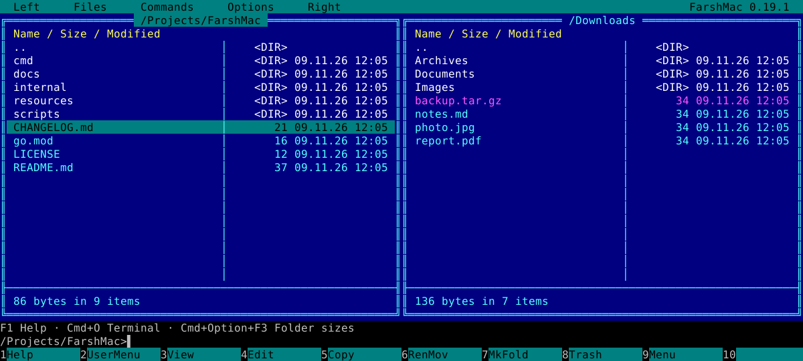

# FarshMac

**The two-panel workflow you know. A Mac window, a real shell, and Go underneath.**

[](https://github.com/ikimpriv/FarshMac/actions/workflows/ci.yml)
[](https://github.com/ikimpriv/FarshMac/actions/workflows/signed-build.yml)
[](LICENSE)
[](https://github.com/ikimpriv/FarshMac/releases)

A native macOS file manager written in Go, inspired by the keyboard-driven workflow and appearance of [Far Manager](https://www.farmanager.com/).

**Version 0.20.0 · macOS 12+ · Apple Silicon and Intel**

[Changelog](CHANGELOG.md) · [File operations](docs/FILE_OPERATIONS.md) · [Contributing](CONTRIBUTING.md)

FarshMac uses a Cocoa window and an offline WebKit/xterm.js interface. It is an independent implementation, not the official Far Manager or a source-compatible port. Far Group does not endorse this project.



*Interface preview rendered by FarshMac with sample files.*

## Download

[**Download the latest preview →**](https://github.com/ikimpriv/FarshMac/releases/tag/v0.20.0)

Unzip the universal macOS archive and move **FarshMac.app** to Applications. Apple Silicon and Intel executables are included. The release includes a SHA-256 checksum.

**Early preview:** builds use a persistent self-signed certificate, not Developer ID or notarization. macOS may require per-app approval in **System Settings → Privacy & Security**. Full Disk Access is a separate, optional permission for protected folders. See the [release notes](docs/releases/v0.20.0.md) for installation details and known limitations.

## Features

- Two file panels, masks and selection, folder bookmarks, sorting, directory sizes, and multiple windows with saved positions and folders.
- Persistent bash, sh, or zsh terminal with bidirectional folder synchronization, color, mouse support, and bounded scrollback spooled to temporary files.
- Internal viewer and editor, Chroma syntax highlighting, autoindent, search, and external application integration.
- ZIP, TAR, compressed TAR, and other archive formats; enter archives as folders and copy files out.
- FTP, FTPS, and SFTP panels, saved connection profiles, and configurable parallel copying.
- Trash by default, explicit permanent deletion, cancellable background operations, and copy metadata options.
- Link-aware local copy and move: relative symbolic links keep pointing at the same object (Smart, the default; As is and Copy contents are also available in the F5/F6 dialog), and hard-linked files copied together stay hard links.
- Graphical image/PDF quick view and an information panel with macOS disk, memory, and power data.

## Build and run

You need **macOS 12 or later**, **Xcode Command Line Tools**, and **Go 1.25 or later**. CGO is required. Node.js 22+ is needed only to run renderer tests. The app bundles its web assets; it does not download scripts at runtime.

Clone the repository, then build:

```sh
git clone https://github.com/ikimpriv/FarshMac.git
cd FarshMac
```

From the repository root:

```sh
xcode-select --install  # only if Command Line Tools are not installed
./scripts/build.sh
open "build/FarshMac.app"
```

For a universal application containing both architectures:

```sh
./scripts/build.sh --universal
```

For development with explicit starting folders:

```sh
go run ./cmd/farshmac -left "$HOME" -right /tmp
```

Local builds automatically reuse the `FarshMac Local Development` code-signing identity if installed; otherwise they use ad-hoc signing. Run `./scripts/setup-local-signing.sh` once to create that identity in login Keychain without an Apple Developer account. macOS may request Keychain approval. This provides stable local signing, but the app is **not notarized**. For local permission behavior, signing, and release packaging, see [Publishing](docs/PUBLISHING.md). Optional Full Disk Access must be enabled by the user in macOS System Settings; the app cannot grant it to itself.

## Keyboard essentials

Most ⌘ shortcuts also work with Ctrl (handy on external keyboards). Ctrl-only: Ctrl+Q, Ctrl+L, Ctrl+H, Ctrl+E/X, Ctrl+1…9, Ctrl+Shift+1…9. ⌘ letter shortcuts follow the physical key on non-Latin keyboard layouts.

| Key | Action |
| --- | --- |
| Tab | Switch active panel (a hidden panel is skipped) |
| Cmd+O | Switch between panels and terminal; synchronize the folder |
| Cmd+Option+F3 | Calculate all displayed folder sizes |
| F3 / F4 | View / edit; F3 on a folder calculates selected folder sizes, F4 on a folder opens File attributes |
| Alt+F3 / Alt+F4 | Alternate viewer / editor; Cmd+Shift+F3 / Cmd+Shift+F4 force the internal one |
| F5 / F6 / F7 | Copy / move / make folder (asks before overwriting; a new destination ending in `/` is created as a folder) |
| Alt+F6 | Create a symbolic link (relative by default) or hard link; naming an existing folder creates the link inside it |
| F8 | Move to Trash |
| Shift+F8 / Shift+Delete | Delete permanently (always asks) |
| Shift+F1 / Shift+F2 / Shift+F3 | Create archive / extract archive / archive commands |
| Alt+F7 / Alt+F8 | Find file / command history (Alt+F8 only inserts the command) |
| Alt+F11 / Alt+F12 | File view/edit history / folder history |
| F9 | Open the menu |
| Cmd+R | Re-read the active panel (F9 → Left/Right → Re-read for a specific panel) |
| Cmd+Shift+. / Ctrl+H | Show / hide hidden files |
| Cmd+Enter | Insert the selected filename into the command line |
| Cmd+F / Cmd+; | Insert the full path from the active / inactive panel |
| Ctrl+Insert / Cmd+C | Copy the command line or selected names (on `..`, the panel path) |
| Shift+Enter | Open with macOS / Finder |
| Ctrl+Q / Ctrl+L | Toggle quick view / information in the other panel |
| Ctrl+Shift+1…9 / Ctrl+1…9 | Save / open folder bookmarks |
| Ctrl+↑/↓, Cmd+↑/↓ | Previous / next command from history |
| Cmd+Shift+H | Shell command history (terminal mode): Enter to run, F4 to edit |
| Cmd++ / Cmd+− / Cmd+0 | Font size larger / smaller / default (10–24); Cmd+= also zooms in terminal mode, in panels it opens the same folder in the other panel |
| Ctrl+Cmd+F | Full screen |
| Cmd+N / Cmd+W | New window (inherits folders and histories) / close window |
| Cmd+Q | Quit; F10 closes only the viewer/editor and does nothing in panels |

In the viewer and editor:

| Key | Action |
| --- | --- |
| F2 | Viewer: toggle wrap (Shift+F2 word/character wrap). Editor: save (Shift+F2 Save as) |
| F6 | Switch viewer / editor, keeping text and cursor |
| F7 / Shift+F7 / Alt+F7 | Search / next / previous match (Space also finds the next match in the viewer) |
| F8 / Shift+F8 | Toggle CP866 / Windows-1251 / choose a code page |
| F9 | Encoding, line endings, BOM, read-only and editor settings |
| F12 | Switch open document screens |
| Cmd+R | Reload from disk (asks if there are unsaved changes) |
| Cmd+Z / Cmd+Shift+Z | Undo / redo (viewer: previous position) |
| Cmd+0…9 / Cmd+Option+0…9 | Go to / set a bookmark (Ctrl+0…9 / Ctrl+Shift+0…9 also work) |
| Ctrl+Insert / Shift+Delete | Copy / cut |

The editor saves atomically and keeps extended attributes, ACLs and hidden/nodump flags; if some cannot be kept it reports "Saved; some attributes were not preserved". A failed save offers Retry / Save as… / Cancel; a file changed or deleted on disk asks before overwriting or recreating it; in an unwritable folder **Save in place** rewrites the file non-atomically and keeps hard links. Opening a file that probably cannot be saved asks View / Edit anyway / Cancel. Saving through a symbolic link writes the link target.

The terminal is bash by default (sh or zsh in Options → Terminal settings) and gets `TERM_PROGRAM=FarshMac`. If the shell exits it restarts with a 1/2/4/8 s backoff and stops after 5 failed starts; press Enter or Cmd+O to retry. Click the status line, or use Commands → **Last messages…**, to see the last 20 messages.

F1 opens the complete in-app keyboard reference. On keyboards configured for media keys, hold Fn to use F1–F12. Files → **Calculate all folder sizes** calculates all displayed folders. Calculated sizes participate in size sorting. They remain in memory when navigating back or refreshing; `~` marks a cached, possibly outdated value, and `>=` marks an incomplete scan. Recalculate with F3 or Cmd+Option+F3. Previous-directory snapshots are limited to 128 directories, 16,384 results, and a 2 MiB estimated storage budget per panel; least recently used snapshots expire. The current panel is separate from this history budget. Sizes are not saved across application restarts.

## Tests

```sh
./scripts/check.sh
./scripts/check.sh --race
```

The suite uses temporary directories and loopback FTP/SFTP servers. No real server credentials are needed. Tests that inspect a personal shell configuration or contact a real SFTP server are opt-in and excluded from the standard check script.

GitHub Actions runs checks and produces an ad-hoc universal ZIP artifact. A separate manual **Signed macOS release** workflow can reuse the same certificate as local builds through protected environment secrets; see [CI signing setup](docs/PUBLISHING.md#moving-signed-builds-to-github-actions). Version tags trigger the signed workflow, which publishes the verified ZIP and checksum after successful checks. Manual runs build artifacts without publishing.

## Scope and limitations

This is an early release. Far Manager plugin binaries and macros are not compatible. Archive panels are read-only; editing an archive member requires extracting it first. Encrypted archives are refused ("Encrypted archives are not supported"), and some nested archive workflows are not supported. Remote metadata and rename behavior depend on the server. SFTP host keys are checked against `~/.ssh/known_hosts`; an unknown host can be trusted once or with **Trust and save**, while a changed or revoked key is refused. Settings are shared live between windows; one instance owns the window session at a time. Windows-specific information and actions are replaced with macOS equivalents.

See [archive support](ARCHIVE_SUPPORT.md), [terminal behavior](TERMINAL_PARITY.md), and [viewer/editor notes](VIEWER_EDITOR_PARITY.md). The detailed parity audits and [development history](docs/DEVELOPMENT_HISTORY.md) record implementation work over time; some older entries describe previous versions.

## Repository layout

- `cmd/farshmac/` — application entry point.
- `internal/ui/` — file panels, menus, dialogs, viewer, and editor.
- `internal/terminal/`, `internal/native/` — PTY sessions, scrollback storage, Cocoa bridge, and bundled renderer.
- `internal/fsops/`, `internal/remotefs/` — local/archive operations and network filesystems.
- `internal/highlight/`, `internal/preview/`, `internal/sysinfo/` — isolated highlighting/preview helpers and macOS information.
- `resources/` — application icon and upstream attribution.
- `scripts/` — checks, building, and release packaging.

## License

Our code is licensed under [MIT](LICENSE). Third-party components retain their respective licenses; see [THIRD_PARTY_NOTICES.txt](THIRD_PARTY_NOTICES.txt). The original Far Manager icon is distributed with its upstream BSD-3-Clause notice and [provenance](resources/upstream/README.md).
